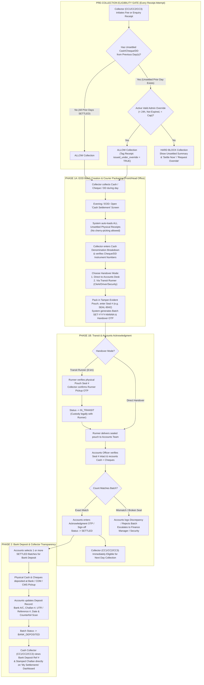
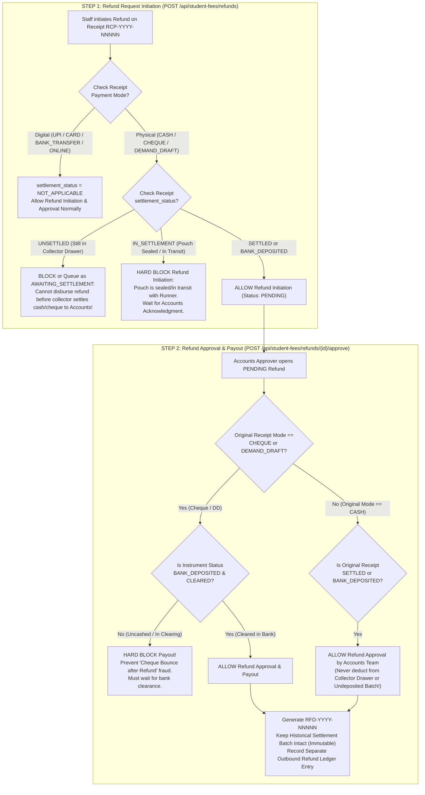
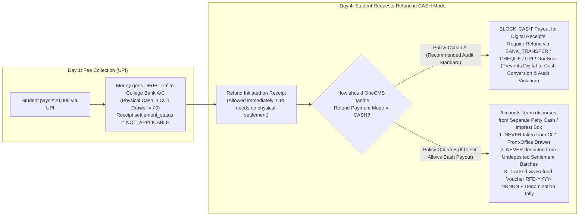
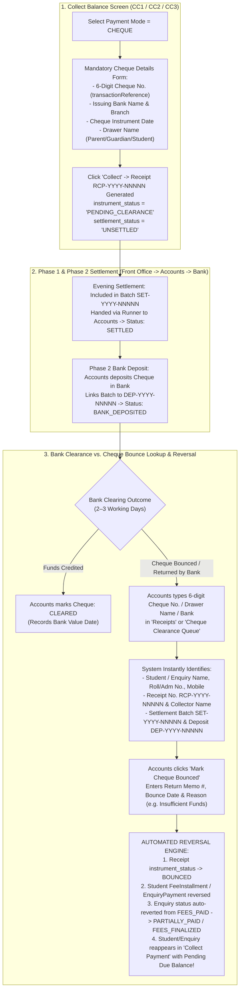
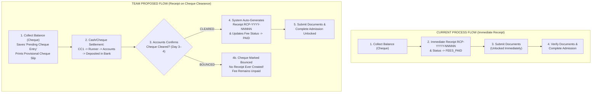

# Cash & Cheque Collection Settlement — Architecture, Refund Integration, Implementation Plan & Conversation Reference (2026-11-07)

> **Reference Context**: This permanent reference document consolidates the earlier discussion in [`docs/cms_cash_collection_flow.md`](file:///home/raster/Projects/OneCMSV2/docs/cms_cash_collection_flow.md) and the complete **2026-11-07** architecture review, **BRD/FRD/SRS**, **Refund Process Integration**, **Codebase Audit**, and **Client Review Checklist**.
>
> **Key Policy Decision**: Per the final review of `docs/cms_cash_collection_flow.md` (line 493), the **3-day multi-day cash holding window has been removed** from the baseline process because allowing unsettled cash/cheques to sit across multiple days creates severe audit and embezzlement risks ("teeming and lading"). This plan enforces **Mandatory Daily Settlement before Next-Day Collection**, backed by a **3-Party Tamper-Evident Courier Transit Protocol** (for the 8 km branch-to-Accounts distance) and a **Strictly Governed College Admin Emergency Override**.

---

## 1. Executive Summary & Practical Scenario (BRD)

### 1.1 Operational Reality
1. **Decentralized Collectors (`CC1`, `CC2`, `CC3`)**: Cash collectors sit in the Front Office, Admission Cell, and Head Office, collecting **Physical Cash**, **Cheques**, and **Demand Drafts (DD)** against Student Fees ([`PaymentCollectionService`](file:///home/raster/Projects/OneCMSV2/backend/src/main/java/com/cms/service/PaymentCollectionService.java)) and Admission Enquiries ([`EnquiryPaymentService`](file:///home/raster/Projects/OneCMSV2/backend/src/main/java/com/cms/service/EnquiryPaymentService.java)).
2. **Mandatory Same-Day / Pre-Collection Settlement**:
   - Every day by evening (End-of-Day cutoff), collectors must settle all physical collections (`CASH`, `CHEQUE`, `DEMAND_DRAFT`).
   - **Hard Pre-Collection Gate**: Before a collector (`CC1`, `CC2`, `CC3`) can collect any payment on the next day, all previous day(s)' physical collections **must be acknowledged as `SETTLED` by the Accounts Team** (or covered by a time-bound Emergency Admin Override).
3. **Physical Transit via Third-Party Runner (Clerk / Driver / Security)**:
   - Because the central Accounts Office can be up to **8 km away**, a designated runner (Clerk, Driver, Security Guard) physically picks up the cash and cheques from `CC1`, `CC2`, `CC3` and delivers them to the Accounts Team.
4. **Accounts Team Acknowledgment (Phase 1 Completion)**:
   - The Accounts Team physically recounts the cash notes and inspects the cheques/DDs.
   - Upon verification and acknowledgment in OneCMS, the settlement batch transitions to `SETTLED`, immediately unlocking the collector for the next collection cycle.
5. **Emergency College Admin Override (Worst-Case Continuity)**:
   - If `CC1` or `CC2` could not settle previous day's collection due to an operational emergency (e.g., courier breakdown, late evening admission drive, Accounts desk unavailable), a user with special `COLLEGE_ADMIN` rights (`CASH_SETTLEMENT_OVERRIDE`) can grant a **temporary override** allowing collection without prior settlement—engineered with hard guardrails so the override itself **cannot become a loophole**.
6. **Phase 2 — Bank Deposit & Collector Transparency**:
   - Once the Accounts Team acknowledges the cash/cheques, they deposit the funds into the institution's bank account.
   - Accounts updates the settlement batch(es) as `BANK_DEPOSITED` with valid reference numbers (**Bank Challan Number, UTR / CDM Reference, Deposit Date, Bank Account, and Stamped Counterfoil upload**).
   - These bank deposit details are **directly visible to the respective Cash Collector (`CC1`, `CC2`, `CC3`)** on their dashboard for end-to-end accountability and peace of mind.

---

## 2. Security Vulnerability Analysis & Zero-Loophole Mitigations

| # | Security Weak Area / Loophole | Real-World Exploitation Scenario | Engineered Zero-Loophole Fix in OneCMS |
| :--- | :--- | :--- | :--- |
| **L-01** | **Collector User Attribution Gap** | Currently, [`PaymentReceipt`](file:///home/raster/Projects/OneCMSV2/backend/src/main/java/com/cms/model/PaymentReceipt.java#L66-L68) and [`EnquiryPayment`](file:///home/raster/Projects/OneCMSV2/backend/src/main/java/com/cms/model/EnquiryPayment.java#L58-L59) only store `collected_by` as a display name (`String`). Display names can collide or change, making per-user blocking bypassable. | Add immutable `collected_by_user_id BIGINT REFERENCES app_users(id)` and `settlement_batch_id` on `payment_receipts`. Gate collection eligibility strictly by authenticated `app_users.id`. |
| **L-02** | **Third-Party Runner "Blame Game"** *(Clerk / Driver / Security)* | Collector hands ₹50,000 to driver; Accounts receives ₹45,000. Collector and driver blame each other with zero forensic proof. | **Tamper-Evident Numbered Security Pouch + 2-Leg OTP Handshake**: Collector seals cash/cheques in a numbered pouch (`pouch_seal_number`), records denomination counts, and hands over to Runner via **Leg-1 Courier Pickup OTP**. Custody legally shifts to Runner (`IN_TRANSIT`). Accounts verifies intact seal before opening (**Leg-2 Accounts Acknowledgment**). |
| **L-03** | **College Admin Override Abuse / Collusion** | College Admin repeatedly grants override to `CC1` every morning, allowing `CC1` to accumulate ₹5 Lakhs over two weeks and abscond. | **5 Hard Guardrails on Override**: <br/>1. **Max 24-Hour Expiry** (auto-expires at EOD).<br/>2. **No Back-to-Back Override**: Cannot grant a second override until the prior unsettled batch is physically `SETTLED`.<br/>3. **Hard Exposure Ceiling** (e.g., max ₹50,000 unsettled; above ceiling blocks override or requires CFO co-sign).<br/>4. **Mandatory Structured Reason Code + Min 25-char Audit Remark**.<br/>5. **Instant Alert** to CFO / Internal Audit & `issued_under_override = true` tag on every receipt issued during the window. |
| **L-04** | **Selective Receipt Omission ("Skimming")** | Collector collects 10 cash receipts (₹80,000), settles only 7 receipts (₹50,000), and rolls 3 receipts into the next day. | **All-or-Nothing Batch Rule**: When creating a settlement batch, the system **auto-includes 100% of unsettled physical receipts (`CASH`, `CHEQUE`, `DEMAND_DRAFT`)** up to that timestamp. Partial/cherry-picked receipt selection is prohibited in the UI and backend API. |
| **L-05** | **Post-Batch Receipt Refund / Tampering** | Collector initiates settlement batch, hands pouch to driver, and simultaneously initiates a refund on a receipt in that batch. | **Immutable Settlement Lock & Gross-Settlement Principle**: In [`FeeRefundService`](file:///home/raster/Projects/OneCMSV2/backend/src/main/java/com/cms/service/FeeRefundService.java), any physical receipt (`CASH`, `CHEQUE`, `DEMAND_DRAFT`) that is `UNSETTLED` or `IN_SETTLEMENT` cannot have a refund disbursed until settled with Accounts. (See Section 4.3 for full Refund Matrix). |
| **L-06** | **Denomination Substitution / Short-Counting** | Collector enters arbitrary lump-sum cash without counting notes, leading to frequent disputes at the Accounts desk. | Reuse and extend [`CashDenominationComponent`](file:///home/raster/Projects/OneCMSV2/frontend/src/app/shared/cash-denomination/cash-denomination.component.ts#L17-L40) (`₹2000` to `₹1` notes & coins) so both Collector (at packaging) and Accounts Officer (at recount) record exact denomination tallies stored in `cash_settlement_denominations`. |
| **L-07** | **Vault Stagnation / Unverified Bank Deposit** | Accounts acknowledges cash from collectors (`SETTLED`) but delays depositing it in the bank for weeks. | **Phase 2 Deposit SLA & Collector Visibility**: Accounts must link settled batches to a `cash_bank_deposits` record with **Bank Challan #, UTR/CDM Ref, Deposit Date, and Scanned Counterfoil**. Collectors see live `BANK_DEPOSITED` status and bank reference numbers on their screen. |
| **L-08** | **Cheque Dishonour / Premature Cheque Refund** | Accounts acknowledges a cheque (`SETTLED`), and a refund is paid out to the student before the cheque clears—then the cheque bounces 4 days later. | **2-Stage Cheque Lifecycle & Refund Gate**: `IN_SETTLEMENT` -> `ACKNOWLEDGED` -> `BANK_DEPOSITED` -> `CLEARED` / `BOUNCED`. Refunds on `CHEQUE` / `DEMAND_DRAFT` receipts cannot be disbursed until the instrument is marked `BANK_DEPOSITED` & `CLEARED` (unless returning the physical undeposited cheque itself). |

---

## 3. End-to-End Secure Process Flow (SRS Diagrams)

### 3.1 Master Process Flowchart (Phase 1 & Phase 2 — Daily Settlement Model)



### 3.2 Three-Party Custody Handshake Sequence (Collector $\rightarrow$ Runner $\rightarrow$ Accounts $\rightarrow$ Bank)

```mermaid
sequenceDiagram
    autonumber
    actor CC as Cash Collector (CC1/CC2/CC3)
    participant SYS as OneCMS Backend
    actor RUN as Transit Runner (Clerk/Driver/Security)
    actor ACC as Accounts Team
    actor ADM as College Admin

    Note over CC,SYS: Next Morning Collection Check
    CC->>SYS: Attempt to collect Student/Enquiry Payment
    SYS->>SYS: Check unsettled receipts where paymentDate < TODAY
    alt Has Unsettled Prior-Day Receipts & No Active Override
        SYS-->>CC: 403 COLLECTION_BLOCKED_UNSETTLED_CASH (Must settle or obtain override)
        opt Worst-Case Emergency Scenario
            ADM->>SYS: POST /api/finance/cash-settlements/overrides (Reason, Max 24h, Cap Check)
            SYS->>SYS: Verify no consecutive override & unsettled <= Cap; Log Audit
            SYS-->>CC: Override Active (24h window) — Collection Unblocked
        end
    end

    Note over CC,ACC: Phase 1 — Evening Settlement & Runner Transit
    CC->>SYS: POST /api/finance/cash-settlements/batches (All unsettled receipts + Denominations + Seal #)
    SYS->>SYS: Lock receipts (SELECT FOR UPDATE), create Batch SET-2026-00001
    SYS-->>CC: Batch Created (Status: PENDING_HANDOVER) + Print Manifest Slip

    RUN->>CC: Arrives at Front Office to pick up sealed pouch
    CC->>SYS: Record Runner Handover (Runner Name/ID/Mobile + OTP/Signature verification)
    SYS->>SYS: Transition Batch -> IN_TRANSIT (Custody: Runner)

    RUN->>ACC: Travels 8 km & hands sealed pouch to Accounts Desk
    ACC->>SYS: Open Batch SET-2026-00001, verify Seal #, input recounted Denominations & Cheques
    ACC->>SYS: POST /api/finance/cash-settlements/batches/{id}/acknowledge
    SYS->>SYS: Transition Batch -> SETTLED, mark all linked receipts SETTLED
    SYS-->>CC: Status updated to SETTLED (Eligible for next collection!)

    Note over ACC,CC: Phase 2 — Bank Deposit & Collector Visibility
    ACC->>SYS: POST /api/finance/cash-settlements/bank-deposits (Batch IDs, Bank Name, Challan #, UTR #, Date)
    SYS->>SYS: Create Deposit DEP-2026-00001, transition linked Batches -> BANK_DEPOSITED
    SYS-->>CC: Collector views Bank Challan #, UTR #, Deposit Date & Counterfoil on Dashboard
```

---

## 4. Functional Requirements Specification (FRD) & Refund Process Integration

### 4.1 Scope of Instruments Subject to Settlement
- **Included (Physical Custody Instruments)**:
  - `CASH`
  - `CHEQUE`
  - `DEMAND_DRAFT`
- **Excluded (Direct-to-Bank Digital Instruments)**:
  - `UPI`, `CARD`, `BANK_TRANSFER`, `ONLINE_RAZORPAY`, `SCHOLARSHIP` (These hit the bank ledger directly and do not require physical pouch handover, though they remain visible in the collector's daily collection summary for reconciliation).

### 4.2 Core Settlement Functional Rules (`FR-01` to `FR-07`)
- **FR-01 (Automatic Collector Ledger Tracking)**: Every receipt saved via [`UnifiedReceiptService.saveStudentReceipt()`](file:///home/raster/Projects/OneCMSV2/backend/src/main/java/com/cms/service/UnifiedReceiptService.java#L91-L105) and [`UnifiedReceiptService.saveEnquiryReceipt()`](file:///home/raster/Projects/OneCMSV2/backend/src/main/java/com/cms/service/UnifiedReceiptService.java#L112-L125) records `collected_by_user_id` (resolved from `CurrentUserResolver`) and initializes `settlement_status = 'UNSETTLED'` for physical payment modes (`CASH`, `CHEQUE`, `DEMAND_DRAFT`), or `'NOT_APPLICABLE'` for digital modes.
- **FR-02 (Pre-Collection Eligibility Gate)**:
  - Invoked at the start of:
    1. [`PaymentCollectionService.collectPayment()`](file:///home/raster/Projects/OneCMSV2/backend/src/main/java/com/cms/service/PaymentCollectionService.java#L97)
    2. [`PaymentCollectionService.collectAdvancePayment()`](file:///home/raster/Projects/OneCMSV2/backend/src/main/java/com/cms/service/PaymentCollectionService.java#L251)
    3. [`EnquiryPaymentService.collectPayment()`](file:///home/raster/Projects/OneCMSV2/backend/src/main/java/com/cms/service/EnquiryPaymentService.java#L107)
  - **Rule**: If the current user has any receipt with `settlement_status != 'SETTLED'` and `settlement_status != 'BANK_DEPOSITED'` where `created_at` (or `payment_date`) is prior to today (`< LocalDate.now()`), AND the user does not have an active, non-expired `SettlementAdminOverride`, throw `SettlementRequiredException` (HTTP `409 Conflict` / `403 Forbidden` with structured payload containing unsettled amount, oldest date, and batch status).
- **FR-03 (All-or-Nothing Settlement Batch Creation)**:
  - Collector clicks **"Initiate Settlement"** on the Cash Settlement screen.
  - System fetches all `UNSETTLED` physical receipts for that collector.
  - Collector enters physical **Cash Denominations** (`₹2000`, `₹500`, `₹200`, `₹100`, `₹50`, `₹20`, `₹10`, `₹5`, `₹2`, `₹1`) which must equal `total_cash_amount`, and verifies each `CHEQUE` / `DEMAND_DRAFT` instrument line (Instrument #, Bank Name, Instrument Date, Amount).
  - Collector enters the **Tamper-Evident Pouch Seal Number** (mandatory when using a transit runner, optional/recommended for direct handover).
- **FR-04 (Transit Runner Handover — Clerk / Driver / Security)**:
  - Collector selects a registered staff user or enters Transit Runner details (Name, Role: `CLERK` / `DRIVER` / `SECURITY`, Employee ID, Mobile Number) and confirms handover via **Handover OTP / PIN** or printed manifest sign-off.
  - Batch status transitions from `PENDING_HANDOVER` $\rightarrow$ `IN_TRANSIT`.
- **FR-05 (Accounts Team Verification & Acknowledgment)**:
  - Accounts user (`CASH_SETTLEMENT_ACKNOWLEDGE` permission) opens the incoming batch.
  - **Self-Approval Prohibition**: `verified_by_user_id` **cannot** equal `collector_user_id` or `courier_user_id` (enforced in backend service and DB check constraint).
  - Accounts confirms seal integrity, inputs verified denomination counts, and clicks **"Acknowledge Receipt"**.
  - Status transitions to `SETTLED`; all linked `payment_receipts` rows update to `settlement_status = 'SETTLED'`.
  - Collector is immediately unblocked for new collections.
- **FR-06 (College Admin Emergency Override with Anti-Loophole Guardrails)**:
  - Granted only by users holding `CASH_SETTLEMENT_OVERRIDE` (assigned to `COLLEGE_ADMIN`).
  - Guardrails enforced by `CashSettlementOverrideService`:
    1. **Cannot self-override** (`approved_by_user_id != collector_user_id`).
    2. **No consecutive override**: If the collector's most recent override has not been followed by a `SETTLED` batch covering the overdue receipts, reject the new override request.
    3. **Max Exposure Cap**: Configurable via System Configuration (`FINANCE_SETTLEMENT_OVERRIDE_MAX_AMOUNT`, default `₹50,000`). If collector's unsettled total exceeds this cap, `COLLEGE_ADMIN` cannot override unless a second higher-tier approver / Finance Head co-approves or the batch is at least marked `IN_TRANSIT`.
    4. **Time-Bound Validity**: Automatically expires at end of current day (`23:59:59`) or after configurable hours (max 24 hours).
    5. **Audit Trail**: Mandatory reason enum (`ACCOUNTS_DESK_CLOSED`, `COURIER_UNAVAILABLE`, `EMERGENCY_ADMISSION_RUSH`, `SYSTEM_DOWNTIME`) + minimum 25-character explanation logged to `AuditLogService`.
- **FR-07 (Phase 2 — Bank Deposit Recording & Collector Visibility)**:
  - Accounts user (`CASH_SETTLEMENT_BANK_DEPOSIT` permission) selects one or more `SETTLED` batches and records the bank deposit:
    - Bank Name & Account Number
    - Deposit Date & Deposit Mode (`BRANCH_COUNTER`, `CDM`, `CMS_PICKUP`)
    - **Bank Challan / Pay-in-Slip Number** (mandatory)
    - **UTR / Bank Transaction Reference Number** (mandatory)
    - Optional attachment/reference URL for the bank-stamped counterfoil
  - Batch status transitions to `BANK_DEPOSITED`, and all linked `payment_receipts` update to `settlement_status = 'BANK_DEPOSITED'`.
  - Cash Collector (`CC1`, `CC2`, `CC3`) sees the live status badge (`BANK DEPOSITED`), Bank Name, Deposit Date, Challan #, and UTR # in their **"My Settlements"** table and detail drawer.

---

### 4.3 Current Codebase Audit: How Refunds Are Generated Today & How They Integrate with Cash Settlement

#### 4.3.1 All 4 Refund Generation Paths in Current Codebase
All refunds are stored in `fee_refunds` ([`FeeRefund.java`](file:///home/raster/Projects/OneCMSV2/backend/src/main/java/com/cms/model/FeeRefund.java)) and generated through **4 paths** in [`FeeRefundService.java`](file:///home/raster/Projects/OneCMSV2/backend/src/main/java/com/cms/service/FeeRefundService.java):

1. **Path 1A — Manual Student Receipt Refund (`entityType = 'STUDENT'`, `source = 'MANUAL'`)**:
   - **Method**: [`FeeRefundService.initiateStudentRefund()`](file:///home/raster/Projects/OneCMSV2/backend/src/main/java/com/cms/service/FeeRefundService.java#L88-L125)
   - **Trigger**: Staff clicks **Request Refund** on **Finance $\rightarrow$ Receipts** (`/receipts`, [`ReceiptsListComponent.confirmRefund()`](file:///home/raster/Projects/OneCMSV2/frontend/src/app/features/finance/receipts-list/receipts-list.component.ts#L262-L283)) $\rightarrow$ `POST /api/v1/student-fees/refunds` (`@perm.has('FEE_REFUND')`).
   - **Behavior**: Sums `amountPaid` across all [`FeeInstallment`](file:///home/raster/Projects/OneCMSV2/backend/src/main/java/com/cms/model/FeeInstallment.java) rows for `receiptNumber` and creates a full-receipt `PENDING` refund.

2. **Path 1B — Manual Pre-Enrollment Enquiry Receipt Refund (`entityType = 'ENQUIRY'`, `source = 'MANUAL'`)**:
   - **Method**: [`FeeRefundService.initiateEnquiryRefund()`](file:///home/raster/Projects/OneCMSV2/backend/src/main/java/com/cms/service/FeeRefundService.java#L127-L156)
   - **Manual UI Verification Steps**:
     1. **Collect Enquiry Payment**: Go to **Admission Management $\rightarrow$ Collect Payment** (`/fee-collection`) *(after finalizing fee in **Admission Management $\rightarrow$ Finalize Fee**)*, select an Enquiry row, and collect payment via `CASH`, `CHEQUE`, `DEMAND_DRAFT`, `UPI`, etc.
     2. **Initiate Refund**: Go to **Finance $\rightarrow$ Receipts** (`/receipts`), filter **All Types $\rightarrow$ Pre-enrollment** (`ENQUIRY`), click the red **Request Refund** icon in the **Actions** column, enter a reason (min. 5 chars), and click **Submit for Approval**.
     3. **Approve/Reject Refund**: Go to **Finance $\rightarrow$ Refunds** (`/refund-approvals`), filter by **Pre-enrollment** (`ENQUIRY`), click the row, and click **Approve** or **Reject**.

3. **Path 2A — Auto-Excess Student Advance Payment (`entityType = 'STUDENT'`, `source = 'AUTO_EXCESS'`)**:
   - **Caller**: [`PaymentCollectionService.collectAdvancePayment()`](file:///home/raster/Projects/OneCMSV2/backend/src/main/java/com/cms/service/PaymentCollectionService.java#L283-L377) $\rightarrow$ [`FeeRefundService.createAutoExcessRefund(Student, receiptNumber, remaining)`](file:///home/raster/Projects/OneCMSV2/backend/src/main/java/com/cms/service/FeeRefundService.java#L165-L185).
   - **Behavior**: Restricted to `DEMAND_DRAFT` and `BANK_TRANSFER` (`FEE_COLLECT_EXCESS`). Records full instrument amount on `PaymentReceipt` and creates a non-rejectable `PENDING` refund (`source = 'AUTO_EXCESS'`) for the surplus over total course fee.

4. **Path 2B — Auto-Excess Enquiry Advance Payment (`entityType = 'ENQUIRY'`, `source = 'AUTO_EXCESS'`)**:
   - **Caller**: [`EnquiryPaymentService.collectPayment()`](file:///home/raster/Projects/OneCMSV2/backend/src/main/java/com/cms/service/EnquiryPaymentService.java#L135-L220) $\rightarrow$ [`FeeRefundService.createAutoExcessRefund(Enquiry, receiptNumber, excessAmount)`](file:///home/raster/Projects/OneCMSV2/backend/src/main/java/com/cms/service/FeeRefundService.java#L190-L208).
   - **Behavior**: Restricted to `DEMAND_DRAFT` and `BANK_TRANSFER` (`ENQUIRY_FEE_COLLECT_ADVANCE`). Records full instrument amount on `PaymentReceipt` and creates a non-rejectable `PENDING` refund (`source = 'AUTO_EXCESS'`) for the surplus.

---

#### 4.3.2 Zero-Loophole Refund Integration Workflow



#### 4.3.3 The 5 Core Rules Governing Refunds + Cash Settlement (`FR-RFD-01` to `FR-RFD-05`)

1. **`FR-RFD-01` — Gross Settlement Principle (Zero Netting in Collector Drawers)**:
   - Front-office cash collectors (`CC1`, `CC2`, `CC3`) **never** pay out cash refunds from their incoming fee collection drawer, and **never** net refunds against their daily collections (`Gross Collected == Physical Pouch Handover`). All refunds are disbursed centrally by the Accounts Team (`FEE_REFUND_APPROVE`).
2. **`FR-RFD-02` — Settlement-First Gate ("No Refund Payout Before Settlement Acknowledgment")**:
   - If a physical receipt (`CASH`, `CHEQUE`, `DEMAND_DRAFT`) is in **`UNSETTLED`** or **`IN_SETTLEMENT`** status, manual refund initiation and approval/payout are blocked until Accounts acknowledges the batch (`SETTLED`).
3. **`FR-RFD-03` — Protection Against "Cheque Bounce After Refund" Fraud**:
   - When the original receipt's `paymentMode` is `CHEQUE` or `DEMAND_DRAFT`, [`FeeRefundService.approveRefund()`](file:///home/raster/Projects/OneCMSV2/backend/src/main/java/com/cms/service/FeeRefundService.java#L212) verifies that the linked `CashSettlementInstrument` has `clearance_status == 'CLEARED'` (after `BANK_DEPOSITED`).
4. **`FR-RFD-04` — Handling `AUTO_EXCESS` Refunds on Demand Drafts (`FEE_COLLECT_EXCESS`)**:
   - Collector settles the **full physical DD amount** in their settlement batch.
   - The auto-generated `AUTO_EXCESS` refund displays **`AWAITING DD BANK DEPOSIT & CLEARANCE`** on the Refunds screen and unlocks for Accounts payout once the DD is `BANK_DEPOSITED` and `CLEARED`.
5. **`FR-RFD-05` — Historical Settlement Immutability & Vault Integrity**:
   - Post-settlement refunds (`RFD-YYYY-NNNNN`) never mutate historical `SET-YYYY-NNNNN` batch totals and are never deducted from undeposited `SETTLED` vault batches (`Batch Total == Bank Challan Total`).

#### 4.3.4 Summary Matrix: Receipt Settlement State vs. Refund Actions

| Original Receipt Mode | Current `settlement_status` | Can Staff Initiate Refund (`FEE_REFUND`)? | Can Accounts Approve / Disburse Refund (`FEE_REFUND_APPROVE`)? | System Guardrail Reason |
| :--- | :--- | :--- | :--- | :--- |
| **`UPI` / `CARD` / `BANK_TRANSFER` / `ONLINE`** | `NOT_APPLICABLE` | **YES** | **YES** | Digital funds are already directly in the institution's bank account. |
| **`CASH`** | `UNSETTLED` *(With Collector)* | **NO** *(Must settle batch first)* | **NO** | Cash is still in front-office collector's drawer; Accounts hasn't received it yet. |
| **`CASH`** | `IN_SETTLEMENT` *(With Runner)* | **NO** | **NO** | Pouch is sealed & in transit; manifest cannot be altered mid-transit. |
| **`CASH`** | `SETTLED` *(In Accounts Vault)* | **YES** | **YES** *(By Accounts)* | Accounts has verified & received the physical cash. Historical batch stays immutable. |
| **`CASH`** | `BANK_DEPOSITED` *(In Bank)* | **YES** | **YES** *(By Accounts)* | Cash is in the bank; Accounts disburses refund voucher `RFD-YYYY-NNNNN`. |
| **`CHEQUE` / `DEMAND_DRAFT`** | `UNSETTLED` or `IN_SETTLEMENT` | **NO** *(Except system `AUTO_EXCESS`)* | **NO** | Physical instrument has not reached Accounts yet. |
| **`CHEQUE` / `DEMAND_DRAFT`** | `SETTLED` *(In Accounts Vault)* | **YES** | **NO** *(Wait for Bank Clearance)* | Prevents disbursing refund money before the cheque/DD is deposited & cleared. |
| **`CHEQUE` / `DEMAND_DRAFT`** | `BANK_DEPOSITED` + `CLEARED` | **YES** | **YES** *(By Accounts)* | Funds are confirmed cleared in the bank; safe to disburse refund. |

#### 4.3.5 Special Scenario Clearance: Student Pays via `UPI` on Day 1 $\rightarrow$ Requests Refund in `CASH` Mode on Day 4



1. **What Happens to Collector (`CC1`) & Settlement Batches?**
   - On Day 1, because the student paid via **`UPI`**, the money went **directly into the College Bank Account**. The front-office collector (`CC1`) received **₹0 in physical cash** for this receipt (`settlement_status = 'NOT_APPLICABLE'`).
   - On Day 4, when the student asks for a refund, **nothing is blocked by `CC1`'s settlement status** because `UPI` is already in the bank.
   - **Crucial Rule**: Front-office collector `CC1` **cannot** hand over cash from their Day 4 fee collection drawer to refund this student. If `CC1` took ₹20,000 out of Day 4's cash collections (paid by other students) to refund the Day 1 `UPI` student, `CC1`'s Day 4 physical cash pouch would be **short by ₹20,000** compared to Day 4's cash receipts!
2. **What Happens at the Accounts Team Desk (`Finance -> Refunds`)?**
   - In the current codebase ([`FeeRefundListComponent`](file:///home/raster/Projects/OneCMSV2/frontend/src/app/features/finance/fee-refund-list/fee-refund-list.component.ts) & [`FeeRefundService.approveRefund()`](file:///home/raster/Projects/OneCMSV2/backend/src/main/java/com/cms/service/FeeRefundService.java#L212-L256)), the approval form defaults `paymentMode` to the original receipt's mode (`UPI`), but allows the approver to switch the dropdown to `CASH`, fill in `<app-cash-denomination>`, and click **Confirm Approve**.
   - **The Accounting & Security Problem with `UPI` $\rightarrow$ `CASH` Refund**:
     - **Bank vs. Vault Mismatch**: The original ₹20,000 came into the **Bank Account** (via UPI), not the physical cash vault. Paying it out in **Physical Cash** drains physical cash without a matching bank withdrawal.
     - **Audit / Compliance Risk**: In institutional audits, refunding a digital receipt (`UPI` / `CARD` / `BANK_TRANSFER`) in physical `CASH` breaks the banking trail (a known "digital-to-cash encashment" loophole).
3. **Two Clear Policy Options to Conclude with the Client**:
   - **Option A — Strict Banking Trail (Recommended Zero-Loophole Rule)**:
     - If the original receipt was paid digitally (`UPI`, `CARD`, `BANK_TRANSFER`, `ONLINE_RAZORPAY`) or via `CHEQUE`/`DEMAND_DRAFT`, **restrict Refund Approval `paymentMode` to Bank modes only** (`BANK_TRANSFER`, `CHEQUE`, `UPI`, `OneBook`) — or allow `CASH` refund **only** up to a small petty-cash ceiling (e.g., $\le \text{₹2,000}$) when original mode was `CASH`.
   - **Option B — Allow `CASH` Refund Strictly from Accounts Imprest / Petty Cash Float**:
     - If the client wants Accounts to be able to pay `CASH` refunds even for `UPI` receipts, the cash **must** be paid out only at the **Accounts Office** from a dedicated **Accounts Petty Cash / Imprest Float** (never from `CC1`'s collection drawer and never deducted from undeposited `SETTLED` collection batches), backed by a signed physical Refund Voucher (`RFD-YYYY-NNNNN`).

---

### 4.4 Cheque Collection, Student Identification Lookup & Cheque Bounce (Dishonour) Plan

#### 4.4.1 Root Cause of the Current Codebase Issue
In the current codebase, when collecting a payment in `CHEQUE` mode on **Admission Management $\rightarrow$ Collect Payment $\rightarrow$ Collect Balance** ([`fee-collection.component.html`](file:///home/raster/Projects/OneCMSV2/frontend/src/app/features/finance/fee-collection/fee-collection.component.html#L374-L389)) or **Finance $\rightarrow$ Fee Explorer $\rightarrow$ Student Fee Detail** ([`student-fee-detail.component.html`](file:///home/raster/Projects/OneCMSV2/frontend/src/app/features/finance/student-fee-detail/student-fee-detail.component.html#L344-L358)):
1. **Missing Cheque Metadata at Collection**: The form only captures `transactionReference` ("UTR / Cheque No."). It does **not** capture **Issuing Bank Name**, **Branch/IFSC**, **Cheque Date**, or **Drawer / Account Holder Name** (critical because parents/relatives often sign the cheque, so the name printed on the physical cheque leaf differs from the student's name).
2. **Cheque Number is NOT Searchable on `Finance -> Receipts`**: In [`PaymentReceiptSpecification.bySearch()`](file:///home/raster/Projects/OneCMSV2/backend/src/main/java/com/cms/repository/PaymentReceiptSpecification.java#L12-L22), the search query only checks `payerName`, `receiptNumber`, `payerIdentifier` (Roll No.), and `admissionNumber`—**it completely omits `transactionReference`!** When the bank returns a bounced cheque leaf, typing the Cheque Number in `Finance -> Receipts` returns **0 results**, leaving the Accounts Team unable to find which student or enquiry gave that cheque.
3. **No Cheque Bounce / Dishonour Reversal Workflow**: Immediately upon clicking **Collect**, the student's `FeeInstallment` or enquiry's `EnquiryPayment` is marked paid (`FEES_PAID`). When a cheque bounces days later, there is no way to mark it `BOUNCED` and automatically reverse the fee payment without misusing the `Refund` flow.

#### 4.4.2 End-to-End Cheque Lifecycle & Bounce Reversal Architecture



#### 4.4.3 Concrete Changes Required for Cheque Identification & Bounce Management

1. **Capture Rich Cheque / DD Details on Collection Screens**:
   - In [`fee-collection.component.html`](file:///home/raster/Projects/OneCMSV2/frontend/src/app/features/finance/fee-collection/fee-collection.component.html) and [`student-fee-detail.component.html`](file:///home/raster/Projects/OneCMSV2/frontend/src/app/features/finance/student-fee-detail/student-fee-detail.component.html), when `paymentMode` is `CHEQUE` or `DEMAND_DRAFT`, show structured fields:
     - **Cheque / DD Number (`transactionReference`)**: Required, 6 digits (`^\d{6}$`) for `CHEQUE`.
     - **Issuing Bank Name (`instrumentBankName`)**: Required (e.g., `State Bank of India`, `HDFC Bank`).
     - **Bank Branch / IFSC (`instrumentBranch`)**: Optional text field.
     - **Cheque / DD Date (`instrumentDate`)**: Required date picker (validated not stale > 90 days).
     - **Drawer / Account Holder Name (`drawerName`)**: Required (pre-filled with Student/Enquiry name, editable if cheque is signed by parent/guardian/sponsor).
   - Persist these 4 new columns (`instrument_bank_name`, `instrument_branch`, `instrument_date`, `drawer_name`) + `instrument_status` (`NOT_APPLICABLE`, `PENDING_CLEARANCE`, `CLEARED`, `BOUNCED`) directly on `payment_receipts`, `fee_installments`, and `enquiry_payments`.

2. **Make Cheque Number, Bank Name & Drawer Name Instant-Searchable in `Finance -> Receipts`**:
   - Update [`PaymentReceiptSpecification.bySearch(String q)`](file:///home/raster/Projects/OneCMSV2/backend/src/main/java/com/cms/repository/PaymentReceiptSpecification.java#L12-L22) to include:
     - `root.get("transactionReference")` (Cheque / DD / UTR Number)
     - `root.get("instrumentBankName")`
     - `root.get("drawerName")`
   - Add an **Instrument Status** filter (`PENDING_CLEARANCE`, `CLEARED`, `BOUNCED`) on **Finance $\rightarrow$ Receipts** and a dedicated **Cheque Clearance & Bounce** sub-tab under **Finance $\rightarrow$ Cash Settlements**.
   - Now, when a physical cheque returns bounced from the bank, typing the **6-digit Cheque Number** immediately displays the exact Student/Enquiry, Receipt Number, Program, Mobile Number, and Collection History.

3. **Dedicated "Mark Cheque Bounced" Action (`POST /api/finance/cash-settlements/cheques/{receiptNumber}/bounce`)**:
   - Gated by `@PreAuthorize("@perm.hasAny('CASH_SETTLEMENT_BANK_DEPOSIT','FEE_REFUND_APPROVE')")`.
   - **Why Separate from Refund**: In a Refund, the college returns money to the student; in a Cheque Bounce, the college never received the money. Keeping Cheque Bounce separate preserves accurate accounting in `fee_refunds`.
   - **Transactional Reversal Logic**:
     - Sets `payment_receipts.instrument_status = 'BOUNCED'`, `bounce_date`, `bounce_reason`, `bank_return_memo_ref`.
     - **If `payerType == 'STUDENT'`**: Soft-flags all [`FeeInstallment`](file:///home/raster/Projects/OneCMSV2/backend/src/main/java/com/cms/model/FeeInstallment.java) rows for that `receiptNumber` as reversed (`refundedAt = Instant.now()`, `refundNumber = "BOUNCED-" + receiptNumber`), immediately restoring the student's pending fee balance.
     - **If `payerType == 'ENQUIRY'`**:
       - Soft-flags the [`EnquiryPayment`](file:///home/raster/Projects/OneCMSV2/backend/src/main/java/com/cms/model/EnquiryPayment.java) row as reversed (`refundedAt = Instant.now()`, `refundNumber = "BOUNCED-" + receiptNumber`).
       - Recalculates the enquiry's net paid amount and **automatically reverts the Enquiry Status** from `FEES_PAID` back to `PARTIALLY_PAID` or `FEES_FINALIZED` (with an audit trail entry in `enquiry_status_history`), blocking admission completion until a valid replacement payment is collected.
       - If the enquiry was already converted to a Student (`convertedStudentId != null`), deletes/reverses any [`EnquiryCreditApplication`](file:///home/raster/Projects/OneCMSV2/backend/src/main/java/com/cms/model/EnquiryCreditApplication.java) rows sourced from that bounced cheque receipt so the admitted student's semester fee balance is immediately restored as due!

---

#### 4.4.4 Architectural Review of Team Proposal: *"Defer Receipt & Fee Status Until Cheque Clears at Accounts/Bank"*

> **Team Question**: *"When making a fee entry with cheque details, we don't know if the cheque will clear or not. Why should we create a receipt immediately? Instead, we should create the receipt and update fee status only after Accounts confirms the cheque has cleared."*

##### Why the Team's Proposal Makes Strong Financial Sense
In strict accounting, a cheque is a conditional instrument ("Subject to Realization"), not settled money. Deferring the official **Fee Receipt (`RCP-YYYY-NNNNN`)** and **`FEES_PAID`** status until bank clearance **completely eliminates**:
- Students walking away with an official "Fee Paid Receipt" and using it for external proof before the cheque clears.
- Having to reverse `FeeInstallment` rows, `EnquiryPayment` rows, `EnquiryCreditApplication` rows, or cancel already-issued `RCP-YYYY-NNNNN` receipts when a cheque bounces.

##### Where This Proposal Deviates from the Current OneCMS Process Flow (6 Critical Deviations)



| # | Process Area in Current Codebase | Current Codebase Behavior | How the Team's Proposal Deviates | Impact & Required Handling if Adopted |
| :--- | :--- | :--- | :--- | :--- |
| **D-01** | **Admission Pipeline Gate (`Submit Documents` $\rightarrow$ `Complete Admission`)** | [`EnquiryService.submitDocuments()`](file:///home/raster/Projects/OneCMSV2/backend/src/main/java/com/cms/service/EnquiryService.java#L599-L604) and [`findDocumentPendingPage()`](file:///home/raster/Projects/OneCMSV2/backend/src/main/java/com/cms/service/EnquiryService.java#L630-L641) **strictly require** `Enquiry.status` to be `PARTIALLY_PAID` or `FEES_PAID` before an enquiry even appears on **Admission Management $\rightarrow$ Submit Documents**. | If `Enquiry.status` is **not** updated to `PARTIALLY_PAID` / `FEES_PAID` when the cheque is collected on Day 1, the prospective student **cannot submit or verify their documents on the same day**—they will be stuck at `FEES_FINALIZED` for 3–4 days until the bank clears the cheque! | **Decision Needed**: Either:<br/>**(a)** Keep Admission strictly blocked for 3–4 days until the cheque clears, **OR**<br/>**(b)** Introduce `CHEQUE_UNDER_CLEARANCE` status that allows **Submit & Verify Documents** on Day 1, but hard-blocks **Complete Admission** (`/enquiries/admission-completion`) until the cheque clears! |
| **D-02** | **Counter Proof Handed to Parent/Student on Day 1** | [`FeeCollectionComponent`](file:///home/raster/Projects/OneCMSV2/frontend/src/app/features/finance/fee-collection/fee-collection.component.ts) immediately prints the official **Fee Receipt (`RCP-YYYY-NNNNN`)** when **Collect** is clicked. | If no `RCP-YYYY-NNNNN` receipt is created on Day 1, the parent/student handing over a ₹50,000 physical cheque gets no receipt at the counter. | System must print a **"Cheque Acknowledgment Slip (`CHQ-ACK-YYYY-NNNNN`)"** on Day 1 stating: *"Received Cheque #123456 for ₹50,000 subject to bank realization. Official Fee Receipt will be generated upon bank clearance."* |
| **D-03** | **Preventing Double Collection While Cheque is In Clearing (Days 1–3)** | [`PaymentCollectionService`](file:///home/raster/Projects/OneCMSV2/backend/src/main/java/com/cms/service/PaymentCollectionService.java#L126-L135) and [`EnquiryPaymentService`](file:///home/raster/Projects/OneCMSV2/backend/src/main/java/com/cms/service/EnquiryPaymentService.java#L122-L124) calculate `collectibleOutstanding` solely from saved `FeeInstallment` / `EnquiryPayment` rows. | If `FeeInstallment` / `EnquiryPayment` is **not** updated on Day 1, the student's **Outstanding Balance on the `Collect Balance` screen will still show the full unpaid amount** during Days 1–3! A second cashier could accidentally collect the same fee again. | The `Collect Balance` and `Student Fee Detail` screens must display **"Cheque Under Clearance: ₹X"** and lock/deduct that amount from `collectibleOutstanding` while the cheque is in `PENDING_CLEARANCE` status. |
| **D-04** | **Cash & Cheque Settlement Batching (`CC1` $\rightarrow$ Runner $\rightarrow$ Accounts)** | Currently, all collections create a `PaymentReceipt` row first, and settlement batches group `PaymentReceipt` rows. | Under the deferred model, on Day 1 Evening when `CC1` hands the physical cheque to the Runner/Accounts, **no `PaymentReceipt` (`RCP-YYYY-NNNNN`) exists yet**! | Settlement Batch (`SET-YYYY-NNNNN`) will link to the `cash_settlement_instruments` (Cheque Deposit Entry) rather than a `PaymentReceipt`. The `PaymentReceipt` is created at the end of Phase 2 (`CLEARED`) and linked back to the instrument. |
| **D-05** | **Student Fee Cascade & Term Allocation Timing** | [`PaymentCollectionService.collectPayment()`](file:///home/raster/Projects/OneCMSV2/backend/src/main/java/com/cms/service/PaymentCollectionService.java#L154-L207) allocates the payment across open semester installments at the moment **Collect** is clicked. | If allocation is deferred 4 days until Accounts clicks **Mark Cheque Cleared**, what happens when Accounts clicks **Clear**? | When `CC1` enters the cheque on the `Collect Balance` screen on Day 1, the system records the exact target Student/Enquiry, Amount, and Mode (`allowAdvance`, `allowExcess`). When Accounts clicks **"Confirm Cheque Cleared"**, the backend automatically invokes `collectPayment()` to generate `RCP-YYYY-NNNNN` and allocate the installments. |
| **D-06** | **Receipt Date (`paymentDate`) vs. Clearance Date** | `PaymentReceipt.paymentDate` is the date entered on the `Collect Balance` screen. | If the cheque is collected on `10-Nov-2026` and cleared by the bank on `14-Nov-2026`, which date appears on `RCP-2026-NNNNN`? | The receipt records both **`Cheque Received Date` (`10-Nov-2026`)** and **`Receipt / Realization Date` (`14-Nov-2026`)**. |

---

## 5. Technical Implementation Plan (Codebase-Mapped)

### 5.1 Database Migration (`V573__create_cash_collection_settlement.sql`)

Create `backend/src/main/resources/db/migration/V573__create_cash_collection_settlement.sql`:

1. **Number Series Definitions** (integrating with [`ApplicationNumberSequenceService`](file:///home/raster/Projects/OneCMSV2/backend/src/main/java/com/cms/service/ApplicationNumberSequenceService.java#L25-L32)):
   - `CASH_SETTLEMENT_NUMBER`: Prefix `SET`, separator `-`, padding `5`, scope `CALENDAR_YEAR` (e.g., `SET-2026-00001`).
   - `BANK_DEPOSIT_NUMBER`: Prefix `DEP`, separator `-`, padding `5`, scope `CALENDAR_YEAR` (e.g., `DEP-2026-00001`).
2. **New Tables**:
   - `cash_bank_deposits`:
     - `id`, `deposit_number` (`UNIQUE`), `bank_name`, `bank_account_number`, `deposit_date`, `deposit_mode`, `challan_number`, `utr_reference`, `total_cash_amount`, `total_cheque_amount`, `total_amount`, `counterfoil_attachment_url`, `remarks`, `deposited_by_user_id`, `deposited_by_name`, `created_at`, `updated_at`.
   - `cash_settlement_batches`:
     - `id`, `settlement_number` (`UNIQUE`), `collector_user_id` (`REFERENCES app_users(id)`), `collector_name`, `collection_location` (e.g., `FRONT_OFFICE`, `HEAD_OFFICE`), `from_date`, `to_date`, `receipt_count`, `total_cash_amount`, `total_cheque_amount`, `total_dd_amount`, `total_batch_amount`, `status` (`PENDING_HANDOVER`, `IN_TRANSIT`, `SETTLED`, `REJECTED`, `BANK_DEPOSITED`), `handover_mode` (`DIRECT_ACCOUNTS`, `COURIER_RUNNER`), `pouch_seal_number`, `handover_otp_hash`, `courier_user_id`, `courier_name`, `courier_role` (`CLERK`, `DRIVER`, `SECURITY`, `OTHER`), `courier_phone`, `courier_picked_up_at`, `verified_by_user_id`, `verified_by_name`, `verified_at`, `verification_remarks`, `rejection_reason`, `bank_deposit_id` (`REFERENCES cash_bank_deposits(id)`), `created_at`, `updated_at`.
     - Constraint `chk_no_self_verification CHECK (verified_by_user_id IS NULL OR verified_by_user_id <> collector_user_id)`.
   - `cash_settlement_denominations`:
     - `id`, `settlement_batch_id` (`REFERENCES cash_settlement_batches(id) ON DELETE CASCADE`), `stage` (`COLLECTOR_DECLARED`, `ACCOUNTS_VERIFIED`), `denomination_value` (`2000, 500, 200, 100, 50, 20, 10, 5, 2, 1`), `note_count`, `line_total`.
   - `cash_settlement_instruments` (for Cheques & Demand Drafts in the batch):
     - `id`, `settlement_batch_id`, `receipt_id` (`REFERENCES payment_receipts(id)`), `receipt_number`, `instrument_type` (`CHEQUE`, `DEMAND_DRAFT`), `instrument_number`, `bank_name`, `instrument_date`, `payer_name`, `amount`, `clearance_status` (`IN_SETTLEMENT`, `ACKNOWLEDGED`, `BANK_DEPOSITED`, `CLEARED`, `BOUNCED`).
   - `settlement_admin_overrides`:
     - `id`, `collector_user_id` (`REFERENCES app_users(id)`), `collector_name`, `approved_by_user_id` (`REFERENCES app_users(id)`), `approved_by_name`, `unsettled_amount_at_grant`, `unsettled_receipt_count`, `reason_code`, `reason_remarks`, `valid_from`, `valid_until`, `status` (`ACTIVE`, `CONSUMED_BY_SETTLEMENT`, `EXPIRED`, `REVOKED`), `created_at`.
     - Constraint `chk_no_self_override CHECK (approved_by_user_id <> collector_user_id)`.
3. **Alter `payment_receipts`**:
   - Add `collected_by_user_id BIGINT REFERENCES app_users(id)` (backfilled for existing rows by matching `payment_receipts.collected_by = app_users.full_name`).
   - Add `settlement_status VARCHAR(30) NOT NULL DEFAULT 'NOT_APPLICABLE'` (`UNSETTLED`, `IN_SETTLEMENT`, `SETTLED`, `BANK_DEPOSITED`, `NOT_APPLICABLE` — backfilled to `'SETTLED'` for historical pre-migration cash/cheque receipts so existing collectors aren't retroactively locked on day 1 of deployment).
   - Add `settlement_batch_id BIGINT REFERENCES cash_settlement_batches(id)`.
   - Add `issued_under_override_id BIGINT REFERENCES settlement_admin_overrides(id)`.
4. **Permissions & Role Seeding**:
   - `CASH_SETTLEMENT_VIEW`: View own settlements, unsettled balance, and bank deposit status (granted to roles with `FEE_COLLECT` or `RECEIPT_VIEW`).
   - `CASH_SETTLEMENT_CREATE`: Create settlement batches and record runner handover (granted to roles with `FEE_COLLECT`).
   - `CASH_SETTLEMENT_ACKNOWLEDGE`: Accounts Team permission to recount, verify, and acknowledge/reject incoming batches (granted to Finance / Accounts roles).
   - `CASH_SETTLEMENT_BANK_DEPOSIT`: Accounts Team permission to record Phase 2 Bank Deposits with Challan/UTR numbers (granted to Finance / Accounts roles).
   - `CASH_SETTLEMENT_OVERRIDE`: Special permission for `COLLEGE_ADMIN` to grant emergency 24-hour collection overrides (granted to `COLLEGE_ADMIN`, `DEV_ADMIN`, `SUPPORT_ADMIN`).

---

### 5.2 Backend Changes (`backend/src/main/java/com/cms/`)

1. **Module Registration**:
   - Update [`ModuleRegistry.java`](file:///home/raster/Projects/OneCMSV2/backend/src/main/java/com/cms/module/ModuleRegistry.java#L56-L61) to add `"CASH_SETTLEMENT_"` to the `FINANCE` module's owned permission prefixes.
2. **User Resolution Enhancement**:
   - Update [`CurrentUserResolver.java`](file:///home/raster/Projects/OneCMSV2/backend/src/main/java/com/cms/util/CurrentUserResolver.java) to add `Optional<AppUser> resolveCurrentAppUser()` and `Long resolveCurrentUserId()` alongside `resolveFullName()`.
3. **Entities & Enums (`com.cms.model` & `com.cms.model.enums`)**:
   - `SettlementStatus.java`: `NOT_APPLICABLE`, `UNSETTLED`, `IN_SETTLEMENT`, `SETTLED`, `BANK_DEPOSITED`.
   - `SettlementBatchStatus.java`: `PENDING_HANDOVER`, `IN_TRANSIT`, `SETTLED`, `REJECTED`, `BANK_DEPOSITED`.
   - `HandoverMode.java`: `DIRECT_ACCOUNTS`, `COURIER_RUNNER`.
   - `OverrideReasonCode.java`: `ACCOUNTS_DESK_CLOSED`, `COURIER_UNAVAILABLE`, `EMERGENCY_ADMISSION_RUSH`, `SYSTEM_DOWNTIME`.
   - `CashSettlementBatch.java`, `CashSettlementDenomination.java`, `CashSettlementInstrument.java`, `CashBankDeposit.java`, `SettlementAdminOverride.java`.
   - Update [`PaymentReceipt.java`](file:///home/raster/Projects/OneCMSV2/backend/src/main/java/com/cms/model/PaymentReceipt.java) with `collectedByUserId`, `settlementStatus`, `settlementBatchId`, `issuedUnderOverrideId`.
4. **Repositories (`com.cms.repository`)**:
   - `CashSettlementBatchRepository.java`, `CashBankDepositRepository.java`, `SettlementAdminOverrideRepository.java`.
   - Extend [`PaymentReceiptRepository.java`](file:///home/raster/Projects/OneCMSV2/backend/src/main/java/com/cms/repository/PaymentReceiptRepository.java) with queries for unsettled physical receipts by `collectedByUserId`, pessimistic lock query (`@Lock(LockModeType.PESSIMISTIC_WRITE)`), and prior-day unsettled check.
5. **Core Services (`com.cms.service`)**:
   - `CashSettlementService.java`:
     - `getCollectorEligibilityStatus(Long userId)`: Computes current unsettled cash/cheque/DD totals, prior-day overdue status, active override status, and returns whether collection is currently `ALLOWED` or `BLOCKED`.
     - `assertEligibleToCollect(Long userId)`: Called by [`PaymentCollectionService`](file:///home/raster/Projects/OneCMSV2/backend/src/main/java/com/cms/service/PaymentCollectionService.java) and [`EnquiryPaymentService`](file:///home/raster/Projects/OneCMSV2/backend/src/main/java/com/cms/service/EnquiryPaymentService.java) before collecting any payment.
     - `createSettlementBatch(CreateSettlementBatchRequest)`: Locks all `UNSETTLED` physical receipts for the collector, validates denomination sum == cash sum, saves batch (`SET-YYYY-NNNNN`), denominations, and cheque/DD instruments.
     - `recordCourierPickup(Long batchId, CourierPickupRequest)`: Validates handover OTP/details, sets `IN_TRANSIT`.
     - `acknowledgeSettlementBatch(Long batchId, AcknowledgeSettlementRequest)`: Enforces four-eyes (`verifier != collector`), records verified denominations, transitions batch & receipts to `SETTLED`, marks any active override as `CONSUMED_BY_SETTLEMENT`.
     - `rejectSettlementBatch(Long batchId, RejectSettlementRequest)`: Logs discrepancy/rejection reason, releases receipts back to `UNSETTLED` so collector can recount and re-submit.
     - `recordBankDeposit(CreateBankDepositRequest)`: Creates `CashBankDeposit` (`DEP-YYYY-NNNNN`) with Bank Challan # & UTR #, transitions all selected `SETTLED` batches and their receipts to `BANK_DEPOSITED`.
     - `grantAdminOverride(GrantSettlementOverrideRequest)`: Enforces the 5 anti-loophole guardrails (no self-override, no back-to-back override without intermediate settlement, exposure cap check, 24h expiry, mandatory reason + audit log).
   - Integrate hooks into:
     - [`UnifiedReceiptService.java`](file:///home/raster/Projects/OneCMSV2/backend/src/main/java/com/cms/service/UnifiedReceiptService.java#L91-L125): Populate `collectedByUserId`, `settlementStatus` (`UNSETTLED` for `CASH`, `CHEQUE`, `DEMAND_DRAFT`), and `issuedUnderOverrideId` (if an override is active).
     - [`PaymentCollectionService.java`](file:///home/raster/Projects/OneCMSV2/backend/src/main/java/com/cms/service/PaymentCollectionService.java#L97) & [`EnquiryPaymentService.java`](file:///home/raster/Projects/OneCMSV2/backend/src/main/java/com/cms/service/EnquiryPaymentService.java#L107): Call `cashSettlementService.assertEligibleToCollect(currentUserId)` at entry.
     - [`FeeRefundService.java`](file:///home/raster/Projects/OneCMSV2/backend/src/main/java/com/cms/service/FeeRefundService.java#L73-L256):
       - In `initiateRefund()`: Block manual refund initiation if `receipt.getSettlementStatus() == UNSETTLED` or `IN_SETTLEMENT` (physical cash/cheque must be settled with Accounts first).
       - In `approveRefund()` and `OneBookService.pushRefundPayment()`: Enforce that for `CASH` receipts, `settlementStatus` must be `SETTLED` or `BANK_DEPOSITED`; for `CHEQUE` and `DEMAND_DRAFT` receipts (including `AUTO_EXCESS` DD refunds), the linked instrument must be `BANK_DEPOSITED` and `CLEARED`.
       - In `toSummaryResponse()`: Expose `originalReceiptSettlementStatus` and `instrumentClearanceStatus` on [`FeeRefundSummaryResponse`](file:///home/raster/Projects/OneCMSV2/backend/src/main/java/com/cms/dto/FeeRefundSummaryResponse.java) so the Refunds UI can display a clear status badge and disable premature approval.
6. **REST Controller (`com.cms.controller.CashSettlementController`)**:
   - `GET /api/finance/cash-settlements/my-status` (`@PreAuthorize("@perm.hasAny('CASH_SETTLEMENT_VIEW','FEE_COLLECT')")`)
   - `GET /api/finance/cash-settlements/batches` (`@PreAuthorize("@perm.has('CASH_SETTLEMENT_VIEW')")`)
   - `GET /api/finance/cash-settlements/batches/{id}` (`@PreAuthorize("@perm.has('CASH_SETTLEMENT_VIEW')")`)
   - `POST /api/finance/cash-settlements/batches` (`@PreAuthorize("@perm.has('CASH_SETTLEMENT_CREATE')")`)
   - `POST /api/finance/cash-settlements/batches/{id}/courier-pickup` (`@PreAuthorize("@perm.has('CASH_SETTLEMENT_CREATE')")`)
   - `POST /api/finance/cash-settlements/batches/{id}/acknowledge` (`@PreAuthorize("@perm.has('CASH_SETTLEMENT_ACKNOWLEDGE')")`)
   - `POST /api/finance/cash-settlements/batches/{id}/reject` (`@PreAuthorize("@perm.has('CASH_SETTLEMENT_ACKNOWLEDGE')")`)
   - `POST /api/finance/cash-settlements/bank-deposits` (`@PreAuthorize("@perm.has('CASH_SETTLEMENT_BANK_DEPOSIT')")`)
   - `GET /api/finance/cash-settlements/bank-deposits` (`@PreAuthorize("@perm.has('CASH_SETTLEMENT_VIEW')")`)
   - `POST /api/finance/cash-settlements/overrides` (`@PreAuthorize("@perm.has('CASH_SETTLEMENT_OVERRIDE')")`)
   - `GET /api/finance/cash-settlements/overrides` (`@PreAuthorize("@perm.hasAny('CASH_SETTLEMENT_OVERRIDE','CASH_SETTLEMENT_ACKNOWLEDGE')")`)

---

### 5.3 Frontend Changes (`frontend/src/app/`)

1. **Navigation & Routing**:
   - Update [`nav-config.ts`](file:///home/raster/Projects/OneCMSV2/frontend/src/app/core/nav/nav-config.ts#L92-L103) under the **Finance** group (`modules: ['FINANCE']`) to add:
     ```ts
     { label: 'Cash Settlements', icon: 'point_of_sale', route: '/cash-settlements', permissions: ['CASH_SETTLEMENT_VIEW', 'CASH_SETTLEMENT_CREATE', 'CASH_SETTLEMENT_ACKNOWLEDGE', 'CASH_SETTLEMENT_BANK_DEPOSIT', 'CASH_SETTLEMENT_OVERRIDE'] }
     ```
   - Register `/cash-settlements` route in [`app.routes.ts`](file:///home/raster/Projects/OneCMSV2/frontend/src/app/app.routes.ts).
2. **Feature Components (`frontend/src/app/features/finance/cash-settlement/`)**:
   - **Collector Eligibility Banner & Pre-Collection Guard** (integrated into `fee-collection.component.ts`, `student-fee-detail.component.ts`, and enquiry payment dialogs):
     - Displays collector's live unsettled cash/cheque total.
     - If blocked due to prior-day unsettled collections, disables the "Collect Payment" submit button and shows a clear callout with a direct **"Go to Cash Settlement"** link and (if applicable) override status.
   - **Refund Screen & Receipt List Guardrails** (integrated into [`fee-refund-list.component.html`](file:///home/raster/Projects/OneCMSV2/frontend/src/app/features/finance/fee-refund-list/fee-refund-list.component.html) & `receipts-list.component.html`):
     - On `Receipts`, disable **"Initiate Refund"** on physical receipts whose `settlementStatus` is `UNSETTLED` or `IN_SETTLEMENT`, showing a tooltip: *"Must be settled with Accounts before initiating a refund."*
     - On `Refunds` (`fee-refund-list.component.html`), if an `AUTO_EXCESS` DD refund or Cheque refund is awaiting settlement/bank clearance, show a warning banner and disable **"Approve"** until `settlementStatus == 'BANK_DEPOSITED'` & `clearanceStatus == 'CLEARED'`.
   - **Tab 1: My Unsettled Collections & Batch Initiation (Collector View)**:
     - Summary cards: Cash in Hand, Cheques/DDs in Hand, Eligibility Status (`ELIGIBLE` / `BLOCKED` / `OVERRIDE ACTIVE`).
     - Auto-selected table of all unsettled physical receipts.
     - Embedded [`<app-cash-denomination>`](file:///home/raster/Projects/OneCMSV2/frontend/src/app/shared/cash-denomination/cash-denomination.component.ts) component (extended to emit denomination counts map `countsChange`) + Pouch Seal # + Handover Mode (`Direct` vs `Transit Runner`).
   - **Tab 2: Accounts Acknowledgment Queue (Accounts Team View)**:
     - Lists batches in `PENDING_HANDOVER` and `IN_TRANSIT`.
     - Side-by-side verification dialog: Collector Declared Denominations vs Accounts Recounted Denominations + Cheque/DD checklist + **"Acknowledge & Settle"** / **"Reject with Discrepancy"**.
   - **Tab 3: Phase 2 — Bank Deposits & Collector Visibility**:
     - For **Accounts Team**: Select multiple `SETTLED` batches $\rightarrow$ click **"Record Bank Deposit"** $\rightarrow$ enter Bank Name, Account #, Deposit Date, Deposit Mode, Bank Challan #, UTR #, and Counterfoil reference.
     - For **Cash Collectors (`CC1`, `CC2`, `CC3`)**: Read-only transparency view showing each settlement batch's **Bank Deposit Status (`BANK DEPOSITED`), Bank Challan Number, UTR Reference, Deposit Date, and Deposited By**.
   - **Tab 4: College Admin Emergency Overrides (`COLLEGE_ADMIN` View)**:
     - View blocked collectors, check unsettled exposure and override history, and grant a 24-hour emergency override with mandatory structured reason code and audit remarks.

---

## 6. Key Discussion Points for Client Meeting

1. **When Does the Collector Unblock Happen (Runner Pickup vs. Accounts Acknowledgment)?**
   - **Strict Rule (Recommended & Default in Plan)**: Collector (`CC1`) is unblocked **only when the Accounts Team acknowledges receipt (`SETTLED`)**.
   - **Optional Client Relaxation**: If the runner takes 1–2 hours to travel the 8 km in the morning, does the client want `CC1` to remain blocked until Accounts clicks Acknowledge, or should `IN_TRANSIT` (after Courier OTP pickup) temporarily allow morning collections while the pouch is on the road?
2. **`COLLEGE_ADMIN` Emergency Override Guardrails**:
   - We have proposed a **₹50,000 maximum unsettled exposure cap** and a **single-day (24-hour) non-repeating limit** for a `COLLEGE_ADMIN` override. Does the client want this ₹50,000 cap configurable in System Settings, or do they want no monetary cap as long as it is strictly limited to 1 day (no back-to-back override)?
3. **Transit Runner Authentication at Front Office**:
   - Will the transit runner (Clerk / Driver / Security) be a registered user in OneCMS who provides a **6-digit Handover OTP**, or do drivers/security guards not have user accounts—in which case the Collector records the Runner's Name, Role, Mobile #, and Pouch Seal # and prints a **2-part physical Gate Pass / Handover Slip** signed by the runner? *(Our schema supports both registered user ID and manual runner details!)*
4. **Demand Drafts (`DEMAND_DRAFT`) Inclusion**:
   - Alongside `CASH` and `CHEQUE`, should physical `DEMAND_DRAFT` receipts also be included in the physical settlement pouch and bank deposit workflow? *(Recommended: Yes, included by default in our plan).*
5. **Refund vs. Settlement Policy (Gross Settlement vs. Same-Day Counter Reversal)**:
   - **Recommended Default (`Gross Settlement — Settle First, Refund Second`)**: Collectors never pay out refunds from their collection drawer. All collected cash/cheques must be settled 100% intact to Accounts, and refunds can only be initiated/disbursed after Accounts acknowledges the batch (for `CASH`) or after Bank Deposit & Clearance (for `CHEQUE` / `DEMAND_DRAFT`).
   - **Question for Client**: Does the client agree with strict **Settle First, Refund Second**, or do they ever require a **Same-Day Counter Cancellation/Void** (e.g., if a cashier enters the wrong amount or student cancels within 10 minutes at the front office before evening settlement, allowing a supervisor-approved void before the pouch is packed)?

---

## 7. Session Conversation Log (2026-11-07)

1. **Request 1**: Review [`docs/cms_cash_collection_flow.md`](file:///home/raster/Projects/OneCMSV2/docs/cms_cash_collection_flow.md) and share the complete implementation plan for client review and discussion prior to implementation.
   - **Outcome**: Reviewed the full history in `docs/cms_cash_collection_flow.md` (including the decision at line 493 to drop the 3-day accumulation window due to risk and enforce daily settlement before next-day collection) and produced the BRD, FRD, SRS, Threat Matrix, and Codebase-Mapped Implementation Plan.
2. **Request 2**: Explain how the existing Refund process is managed within the Cash Settlement process and update the plan accordingly.
   - **Outcome**: Audited [`FeeRefundService.java`](file:///home/raster/Projects/OneCMSV2/backend/src/main/java/com/cms/service/FeeRefundService.java) and [`FeeRefundListComponent`](file:///home/raster/Projects/OneCMSV2/frontend/src/app/features/finance/fee-refund-list/fee-refund-list.component.ts) and designed the 5 Zero-Loophole Refund Integration Rules (`FR-RFD-01` through `FR-RFD-05`), covering the Gross Settlement Principle, `UNSETTLED`/`IN_SETTLEMENT` locks, Uncleared Cheque/DD refund protection, `AUTO_EXCESS` DD handling, and historical batch immutability.
3. **Request 3**: List all ways a Refund can be generated in the current codebase and share the exact Menu $\rightarrow$ Menu Item navigation for testing Path 1B (`initiateEnquiryRefund`).
   - **Outcome**: Documented all 4 refund generation paths (`initiateStudentRefund`, `initiateEnquiryRefund`, `createAutoExcessRefund(Student)`, `createAutoExcessRefund(Enquiry)`) and the step-by-step UI paths (**Admission Management $\rightarrow$ Collect Payment**, **Finance $\rightarrow$ Receipts** filtered by **Pre-enrollment**, and **Finance $\rightarrow$ Refunds**).
4. **Request 4**: Save this conversation and specification as a permanent file in the `docs/` folder for reference.
   - **Outcome**: Saved permanently to [`docs/CASH_COLLECTION_SETTLEMENT_IMPLEMENTATION_PLAN.md`](file:///home/raster/Projects/OneCMSV2/docs/CASH_COLLECTION_SETTLEMENT_IMPLEMENTATION_PLAN.md).
