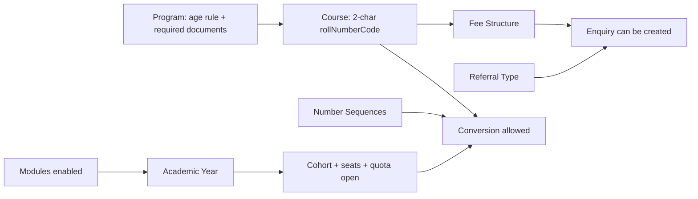
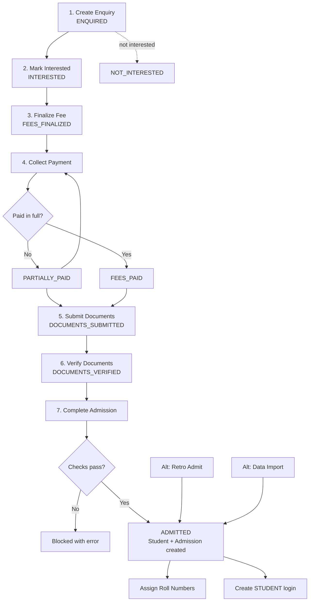
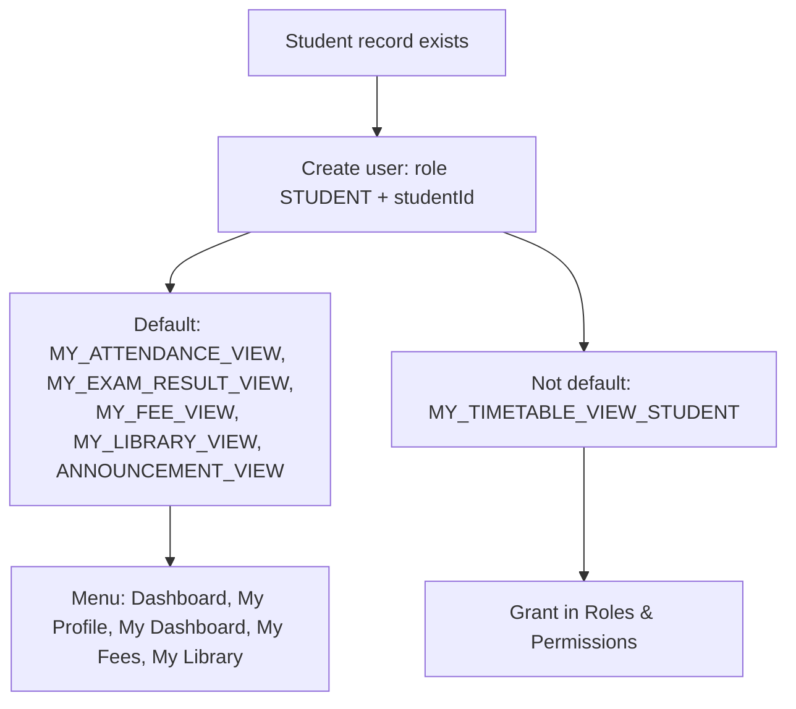

# Student Creation – User Guide

How a person becomes a student in OneCMS V2: menu order, one-time setup, the admission pipeline, and student login.
Derived from a direct review of the frontend nav (`core/nav/nav-config.ts`), backend services and DB migrations.

> Menu items show only if the user holds at least one of the item's permission codes **and** the item's module is enabled for the deployment. Module gating always wins.

---

## 1. Sidebar menu order

| # | Group (module) | Items in order |
|---|---|---|
| 1 | **Overview** (core) | Dashboard · My Profile · My Timetable (Student) · My Timetable (Staff) · My Dashboard · My Fees · My Wards · Ward Fees |
| 2 | **Admission Management** (ADMISSIONS) | Enquiries · Finalize Fee · Collect Payment · Submit Documents · Verify Documents · Complete Admission · Admission Explorer · AI Document Search · Retro Admit |
| 3 | **Student Management** (STUDENT_MGMT) | Student Explorer · AI Smart Search · Assign Roll Numbers · Scholarship Applications · Data Import |
| 4 | **Finance** (FINANCE) | Fee Explorer · Receipts · Refunds · Commissions |
| 5 | **Academics** (ACADEMICS) | Curriculum Versions · Syllabus · Experiments · CO/PO Mapping · Course Offerings · Elective Assignment · Capacity Auto-Plan · Assign Faculty · Recurring Unavailability · Timetable Builder · Timetable · Resource Timetable · Class Schedules · Faculty Absence · My Special Classes · Special Class Approvals · My Escort Duties · Attendance · Progress Report · Manage Exams · Exam Results · Student Promotion |
| 6 | **Library** (LIBRARY) | Issue Books · Issue Explorer · Overdue Books · Book Explorer · Journal Explorer · My Library · Fines · Racks & Shelves · Import · Library Settings |
| 7 | **Core Infrastructure** (CORE_INFRA) | Campus Infrastructure · Room Purpose Categories · Room Sub-Types |
| 8 | **Maintenance** (INVENTORY) | Maintenance Requests |
| 9 | **Stock Management** (INVENTORY) | Dashboard · Products · Categories · Units of Measure · Brands · UOM Conversion Templates · Locations · Storage Racks · Stock Balance · Cycle Counts · Stock Valuation · Goods Receipts · Stock Transfers · Supplier Returns · Reorder Configuration · Stock Indents · Loanable Item Issues |
| 10 | **Purchasing & Suppliers** (INVENTORY) | Suppliers · Rate Contracts · Vendor Product Rates · Price Comparison · Purchase Requisitions · Quotation Requests · Wanted List · Purchase Orders · PO Aging Report · PO Cycle-Time Report · Tax Rules · Currency Settings · Currency Exchange Rates |
| 11 | **Equipment & Asset Management** (INVENTORY) | Asset Register · Maintenance Schedules · Service Contracts · Depreciation Summary |
| 12 | **Budgets & Approvals** (INVENTORY) | Budgets · Budget vs. Actual · Approval Workflows · Approvals |
| 13 | **Gate Pass & Service Requests** (INVENTORY) | Gate Passes · Consignment Agreements · Consignment Stock · Service Tickets · Ticket Categories |
| 14 | **Hostel Management** (HOSTEL) | Hostel Room Types · Room Preferences · Room Allocation |
| 15 | **Reports & Analytics** (REPORTS) | General Reports · Fee Reports |
| 16 | **Preferences** (group ungated; items gated individually) | *Admissions:* Agents · Institutions · Referral Types · Staff Referrers. *Student:* Blood Groups · Communities · Scholarship Types. *Finance:* Fee Structures. *Academics:* Academic Calendar · Academic Years · Classrooms · Clinical Venues · Courses · Faculty · Faculty Doc Config · Faculty Workload Rules · Holiday Templates · Labs · Periods · Programs · Specialities · Subjects. *Inventory:* Equipment. *Core:* Designations · Location Master · Number Sequences · Settings |
| 17 | **User Management** (core) | Users · Roles & Permissions · Permission Tiers |

```mermaid
flowchart LR
    A1["1 Overview"] --> A2["2 Admission Mgmt"] --> A3["3 Student Mgmt"] --> A4["4 Finance"] --> A5["5 Academics"] --> A6["6 Library"] --> A7["7 Core Infra"] --> A8["8-13 Inventory groups"] --> A9["14 Hostel"] --> A10["15 Reports"] --> A11["16 Preferences"] --> A12["17 User Mgmt"]
```

---

## 2. One-time setup (before any admission)

| # | What | Where | Notes |
|---|---|---|---|
| 1 | Enable modules | `app.modules.enabled` property | `ADMISSIONS`, `STUDENT_MGMT`, `FINANCE`, `ACADEMICS`. `FINANCE` requires `ACADEMICS`. Unset = all enabled. |
| 2 | Academic Year + Cohort | Preferences → Academic Years | Start year/date; initialize cohort for program/course/year. |
| 3 | Program | Preferences → Programs | Optional minimum age + cutoff day/month (enforced at enquiry and conversion). Set mandatory/optional document types. |
| 4 | Course | Preferences → Courses | **2-character `rollNumberCode` is required**; admission-number generation fails without it. |
| 5 | Cohort seats / quota | Academic Years | Total, management, counselling seats; quotas must be open. Conversion is blocked when closed or full (management overflow is allowed). |
| 6 | Fee Structure | Preferences → Fee Structures | Drives fee estimate and finalization. Finalization can only discount, never increase. |
| 7 | Referral Type | Preferences → Referral Types | Mandatory on an enquiry. Agents / Institutions / Staff Referrers optional. |
| 8 | Fee State, Location Master | Preferences | For enquiry fee-state and address fields. |
| 9 | Number Sequences | Preferences → Number Sequences | Admission, receipt, refund, commission series (seeded by migration). |
| 10 | Optional masters | Preferences | Blood Groups, Communities, Scholarship Types. |

---

## 3. Admission pipeline

| Step | Menu | Permission | Enquiry status after |
|---|---|---|---|
| 1 | Admission Management → Enquiries (create) | `ENQUIRY_CREATE` | ENQUIRED |
| 2 | Mark Interested (Program + Course required) | `ENQUIRY_EDIT` | INTERESTED |
| 3 | Finalize Fee (discount only; reason required) | `FEE_FINALIZE` | FEES_FINALIZED |
| 4 | Collect Payment | `FEE_COLLECT` | PARTIALLY_PAID → FEES_PAID when fully paid |
| 5 | Submit Documents (all mandatory present) | `DOCUMENT_SUBMISSION_MANAGE` + `ENQUIRY_EDIT` | DOCUMENTS_SUBMITTED |
| 6 | Verify Documents | `DOCUMENT_VERIFICATION_MANAGE` | DOCUMENTS_VERIFIED (automatic once all mandatory docs verified) |
| 7 | Complete Admission (Convert form) | Menu: `ADMISSION_COMPLETE`; API: `ENQUIRY_EDIT` | **ADMITTED** |

Step 7 validates: status is DOCUMENTS_VERIFIED, all mandatory documents verified, seat availability and quota open, unique student email, program age rule. It then creates the Student (ACTIVE) and Admission, generates the admission number (academic-year start year + course `rollNumberCode`), carries over the room preference, links enquiry documents, and auto-creates the fee allocation.

**Alternative routes**
- **Retro Admit** (`RETRO_ADMIT`): for already-enrolled students. Needs unique email, roll number, university registration number, and at least one year of fees.
- **Data Import** (`IMPORT_DATA`): bulk import.

---

## 4. After admission

- **Assign Roll Numbers** (Student Management): menu `ROLL_NUMBER_ASSIGN`, backend checks `STUDENT_CREATE`.
- **Cohort / section enrollment**: via Student Promotion, Elective Assignment and term enrollment.

---

## 5. Student login

Admission does **not** create a login automatically.

1. User Management → Users → Create, role **STUDENT**.
2. The backend accepts `studentId` on user creation to link the account to the student record; all "My …" screens resolve the student through this link. The Users form does not expose a student picker, so the link is set via API (`POST /user-management` with `studentId`; see `scripts/verify_student_portal_self_service.py`).
3. A Keycloak account is created with a temporary password; the student must change it at first login.

Default STUDENT role permissions:

| Area | Permissions |
|---|---|
| Base | `STUDENT_VIEW`, `ATTENDANCE_VIEW`, `EXAM_RESULT_VIEW` |
| Library | `LIBRARY_CATALOGUE_VIEW`, `LIBRARY_ISSUE_VIEW`, `MY_LIBRARY_VIEW` |
| Self-service | `MY_ATTENDANCE_VIEW`, `MY_EXAM_RESULT_VIEW`, `MY_FEE_VIEW` |
| Announcements | `ANNOUNCEMENT_VIEW` |

Resulting menu: Dashboard, My Profile, My Dashboard, My Fees, Library → My Library.
**Not auto-granted:** `MY_TIMETABLE_VIEW_STUDENT` – grant it in Roles & Permissions to show "My Timetable (Student)".

---

## 6. Known gotchas

- **Permission mismatch for Complete Admission:** menu `ADMISSION_COMPLETE`, route guard `ADMISSION_CREATE`/`ADMISSION_EDIT`, API `ENQUIRY_EDIT`. Give the admission officer role all of them.
- **STUDENT role may be missing:** migration `V125` deletes the seeded role when no users reference it. Verify under Roles & Permissions and create it if needed.
- **Student email must be unique**, or conversion fails.
- **Only ENQUIRED enquiries can be deleted.**
