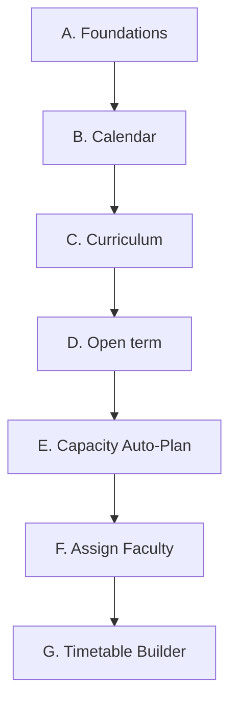

# Timetable Creation — Reference Guide (OneCMS)

Derived from a code audit (Angular `nav-config.ts` / `app.routes.ts`; Spring Boot `Timetable*Service`,
`TermInstanceService`, `AcademicYearService`, and the entities). Items marked **(unverified)** were not fully
traced in code.

Menu paths are written as **Group › Item**, using the labels in `nav-config.ts`. An item is visible only if
the user holds its permission **and** its feature module is enabled.

---

## 1. Master data and settings required

| Area | Entity / setting | Key fields | Needed for |
|---|---|---|---|
| Daily grid | `Period` | name, start/end time, `periodOrder`, `isActive` | Every placement. Lunch is *derived*: the single longest gap between consecutive active periods is lunch, shorter gaps are recess (`PeriodGapPolicy`) — period times must be correct |
| Rooms | `Room` hierarchy | Branch → Block → Floor → Zone → Room, purpose category, sub-type | Parent of classrooms/labs/venues |
| Teaching rooms | `Classroom`, `Lab`, `ClinicalVenue` | name, `capacity`, linked `Room` | Theory sections, lab batches, clinical batches are sized to capacity |
| Subjects | `Subject` + join tables `subject_eligible_labs`, `subject_eligible_clinical_venues`, `subject_eligible_faculty` | speciality, credits, eligibility lists | Staffing considers only eligible faculty/labs/venues |
| Faculty | `Faculty`, `DesignationMaster` | speciality, designation, optional per-faculty caps | Staffing candidates and workload caps |
| Calendar | `AcademicYear`, `TermInstance` | term dates, status, `workingSaturdayWeeks`, seat allocation per program | Term scope; **cohorts are created with the Academic Year** |
| Non-teaching time | `BlockedPeriod`, holiday/calendar events | block type (specific date / day-of-week / date range), period | Blocked day+period cells are never placed |
| Curriculum | `CurriculumVersion`, `CurriculumSemesterCourse` | program, course, effective-from year; per subject theory/lab/clinical hours, core/elective, elective group | Source of course offerings and hours to cover |
| Offerings | `CourseOffering` | subject, cohort, clinical shift duration, travel buffer | The unit that is staffed and placed |
| Rooms/batches | `CohortRoomAllocation` → `CohortSection`, lab/clinical batches | committed per cohort per term | Exclusive room claim; **required before placement** |
| Staffing | `CourseOfferingSectionFaculty` | theory faculty per section; coordinator per lab/clinical batch | Publish gate |
| Constraints | `FacultyAvailability` | day, time range, optional date range | Hard constraint during staffing |

### System settings (`timetable.*`)
| Key | Purpose | Default |
|---|---|---|
| `timetable.faculty_max_daily_sessions` | Daily teaching cap | none (blank = no cap) |
| `timetable.faculty_max_weekly_sessions` | Weekly cap (designation/faculty can override) | none |
| `timetable.faculty_max_continuous_sessions` | Max unbroken run | none |
| `timetable.faculty_min_weekly_sessions` | Minimum weekly load | none |
| `timetable.library_sessions_per_week` | Library filler sessions | (unverified) |
| `timetable.library_block_size_periods` | Library block length | 2 |
| `timetable.sports_sessions_per_week` | Sports filler sessions | (unverified) |
| `timetable.sports_block_size_periods` | Sports block length | 2 |
| `timetable.self_study_sessions_per_week` | Self-study filler | (unverified) |
| `timetable.self_study_block_size_periods` | Self-study block length | (unverified) |

The four faculty caps are edited via **Faculty Workload Rules**. Whether **Settings** exposes the
library/sports/self-study keys is **(unverified)**.

---

## 2. Menu → item sequence

### A. Foundations
1. **Preferences › Programs**
2. **Preferences › Specialities**
3. **Preferences › Designations**
4. **Core Infrastructure › Campus Infrastructure**
5. **Core Infrastructure › Room Purpose Categories**
6. **Core Infrastructure › Room Sub-Types**
7. **Preferences › Classrooms** — capacity + room link
8. **Preferences › Labs** — capacity + room link
9. **Preferences › Clinical Venues** — capacity + room link
10. **Preferences › Periods** — daily grid
11. **Preferences › Subjects** — eligibility lists
12. **Preferences › Faculty**
13. **Preferences › Faculty Workload Rules**
14. **Preferences › Settings** — library / sports / self-study keys **(unverified)**

### B. Calendar
15. **Preferences › Academic Years** — year, terms, seat allocation (creates cohorts)
16. **Preferences › Holiday Templates**
17. **Preferences › Academic Calendar** — events and blocked periods

### C. Curriculum
18. **Academics › Curriculum Versions** — hours per subject per semester, elective groups
19. **Academics › Syllabus**
20. **Academics › Experiments**
21. **Academics › CO/PO Mapping**

Steps 19–21 showed no hard timetable block in code **(unverified)**.

### D. Open the term
22. **Preferences › Academic Years** (term row) — advance status to **OPEN**; offerings are auto-generated. The advance checklist warns about active cohorts with no curriculum version
23. **Academics › Student Promotion** / **Admission Management** — student term enrolment
24. **Academics › Course Offerings** — verify; set clinical shift duration/travel buffer
25. **Academics › Elective Assignment**

### E. Rooms and batches
26. **Academics › Capacity Auto-Plan** — review and commit room allocation per cohort (creates sections and batches)

### F. Faculty
27. **Academics › Assign Faculty**
28. **Academics › Recurring Unavailability**

### G. Build and publish
29. **Academics › Timetable Builder** — select year/term, set working Saturdays, run Global Auto-Schedule, fix gaps, run conflict inspection and acknowledge per cohort, approve/publish

---

## 3. Validation gates (what blocks you)

**Global Auto-Schedule run** (`TimetableGlobalAutoScheduleService`)
- Any faculty over term capacity (`GLOBAL_AUTO_SCHEDULE_OVER_CAPACITY`)
- Any lab/clinical venue over weekly capacity (`GLOBAL_AUTO_SCHEDULE_VENUE_OVER_CAPACITY`)
- Single-cohort run on an already-published cohort (`GLOBAL_AUTO_SCHEDULE_TERM_PUBLISHED`); an "All cohorts" run skips published cohorts and reports them
- Another run already in progress for the term

**Prerequisite checklist** (`checkPrerequisites`): offerings/elective options with faculty status NONE or PARTIAL; clinical shift leaving a day with no periods.

**Publish** (`TimetableGenerationService.approve`), in order:
1. Term is not `LOCKED` (`TIMETABLE_TERM_LOCKED`)
2. No unstaffed cells; Library sessions are exempt (`TIMETABLE_UNSTAFFED_CELLS`)
3. No offering lacking theory faculty or lab/clinical coordinator (`TIMETABLE_OFFERING_UNASSIGNED_FACULTY`)
4. Conflict scan is clean
5. A fresh conflict acknowledgment exists per cohort (`TIMETABLE_CONFLICT_ACKNOWLEDGMENT_REQUIRED`)
6. Curriculum-hours coverage is complete — overridable with a mandatory reason (`TimetableCoverageGapException`)

**Revert / discard** is refused once attendance is recorded (`TIMETABLE_ATTENDANCE_RECORDED`) or real session activity exists (`TIMETABLE_SESSION_ACTIVITY_RECORDED`).

**Locking a term** is checked against outstanding fee demands; draft timetable sessions are counted in its checklist.

---

## 4. Notes
- Cohorts are created only through the Academic Year seat allocation; there is no separate Cohort menu item.
- Library and Sports cells have no `CourseOffering` and no curriculum-hours budget. Sports needs a faculty and room resolved server-side; the exact room-tag rule is **(unverified)**.
- Where Holiday Templates and Day Mappings feed skeleton generation is **(unverified)**; `TimetableBlockedPeriodChecker` references blocked periods only.
- Do not edit Period times once a term is live; placements are stored against the period grid.

## 5. After publish (on-demand)
**Overview › My Timetable**, **Academics › Timetable**, **Resource Timetable**, **Class Schedules** (swap/reschedule one occurrence), **Faculty Absence**, **My Special Classes** / **Special Class Approvals**, **My Escort Duties**, **Attendance**, **Progress Report**.
